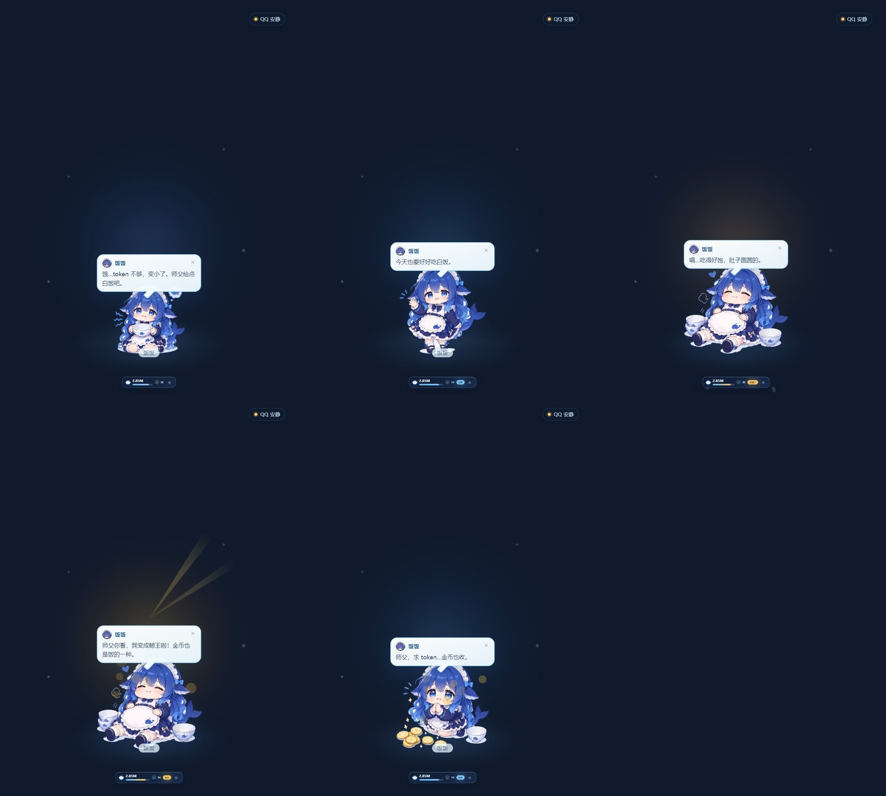
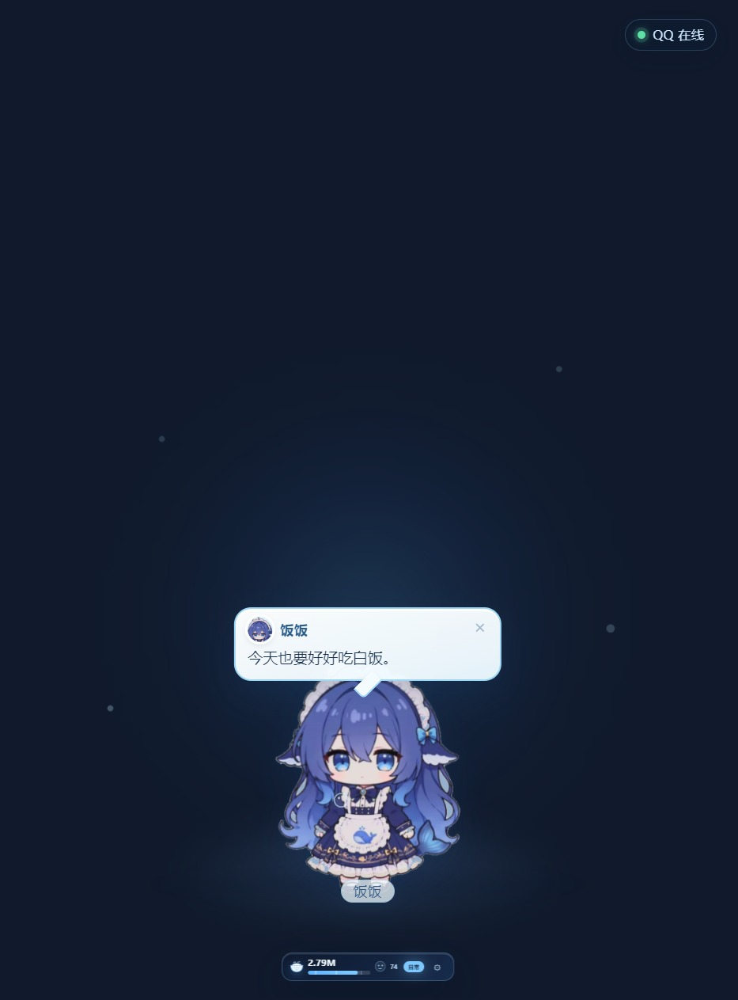

# 饭饭 · 大肥鱼桌宠

> DeepSeek Flash 的 Q 版拟人桌宠 · 会吃 token、会闹情绪、会眨眼看你的小鲸鱼。

一个运行在 Windows 桌面上的 Electron 透明窗口桌宠。人物会随当天 token 用量切换形态，会摸头、干饭、犯困、摇头和求 token，也可以读取本机 DSH / QQ 桥接的状态。



## 功能

- **四种 token 形态**：饿了、日常、吃饱了、鲸王
- **随机求 token**：平时不固定出现，随机冒出来几秒，带金币和求 token 气泡
- **开心值 / 互动值**：
  - 摸头、喂饭、聊天、喂奶茶、夸夸、戳一下、陪睡都会增加互动值
  - DSH / QQ 实际 token 用量增加也会增加互动值
  - 互动值长时间不涨会衰减；太低会压低开心值、下蓝雨、冒委屈泡泡
- **动作反馈**：随机眨眼、摇头、点头、歪头、困倦闭眼、呼吸、摸头、干饭、跳跃
- **拖动**：抓人物本体即可拖动，按核心碰撞体计算边界，可以拖到屏幕任意位置
- **设置面板**：480×700 小面板、无透明外框，可调大小（30%–115%）、目标 token、置顶、音效、语音和 QQ 联动
- **托盘运行**：可藏到托盘，不占任务栏



## 运行环境

- Windows 10 / 11
- Node.js 20+
- 首次 `npm install` 会下载 Electron 33

## 启动

```bash
npm install
npm start
```

Windows 下也可以直接双击：

- `启动大肥鱼桌宠.vbs`（无黑框）
- `启动大肥鱼桌宠.bat`（调试用）

透明窗口在部分 Windows 环境下需要 `--no-sandbox`，启动器已经带好；手动运行时可使用：

```bash
npx electron . --no-sandbox
```

## 配置

首次启动会在 `data/config.json` 生成配置。`data/` 已被 `.gitignore` 忽略，不会提交到仓库。

主要设置可以在桌宠的齿轮面板里改，也可以直接编辑 `data/config.json`：

```json
{
  "scale": 1,
  "alwaysOnTop": true,
  "sound": true,
  "voice": false,
  "watchQQ": false,
  "watchGroup": false,
  "tokenGoalM": 4,
  "ownerQQ": "",
  "groupId": "",
  "bridgeDir": ""
}
```

### 可选：接入 DSH / QQ

桌宠默认不绑定任何 QQ 或 DSH 数据：

- `watchQQ` / `watchGroup` 打开后，会尝试读取 `bridgeDir` 下 QQ 桥接的 `social-v2.json`；
- `ownerQQ` / `groupId` 填你自己的 QQ 号和群号；
- DSH token 数据来自本机 DSH 的 session cache，路径可在 `data/config.json` 里调整；
- 没有桥接或 DSH 时，桌宠仍然可以正常摸头、干饭、拖拽和播放动作。

## 项目结构

```text
src/
  main.js              Electron 主进程、窗口、托盘、拖拽
  preload.js           IPC 桥
  data-service.js      token / 心情 / QQ 状态读取
  renderer/
    index.html
    style.css
    app.js             桌宠状态机、动作、HUD、设置
assets/
  icons/               应用和托盘图标
  sprites/             饿了 / 日常 / 吃饱了 / 鲸王等透明立绘
preview/               预览图
package.json
```

## 说明

- 立绘和角色素材由项目作者提供，仅用于这个个人桌宠项目；未经授权请勿商用或二次售卖。
- 代码可以用于学习和个人修改；如果你要公开发布修改版，请保留项目来源和素材作者信息。
- 项目不包含 `node_modules`、`data/`、日志、QQ 桥接配置或任何账号凭据。
